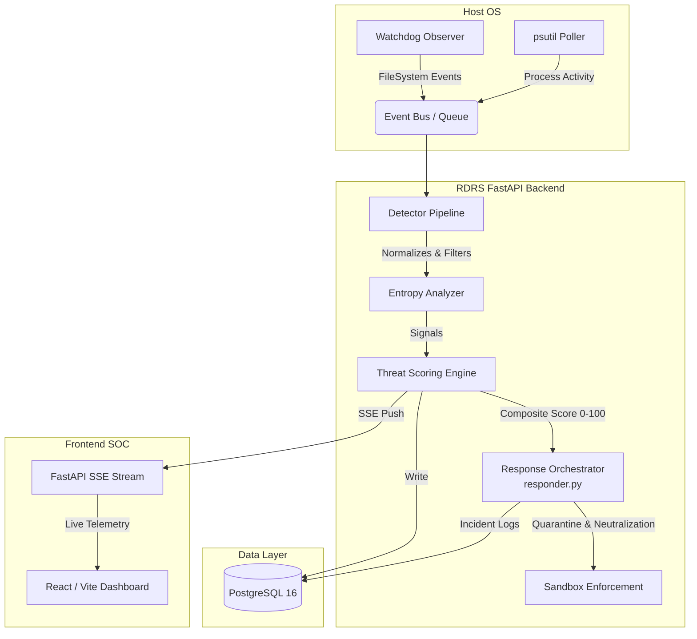

# RDRS — Architectural Blueprint

> **Document Type:** System Architecture Reference  
> **Version:** 2.0.0  
> **Audience:** Backend Engineers, Security Analysts, SOC Integrators

---

## 1. Executive Overview

The **Ransomware Detection and Response System (RDRS)** is a layered, real-time behavioral analysis engine. It passively monitors filesystem events and process activity on a host, calculates a continuous **Threat Score (0–100)** using a sliding-window algorithm, persists all events and scores to a PostgreSQL database, and surfaces analysis data through a FastAPI-backed REST API consumed by a React dashboard via SSE (Server-Sent Events).

---

## 2. High-Level Architecture & Data Flow

The following diagram illustrates the complete data lifecycle, from initial host telemetry to real-time React UI updates:

---

## 3. Core Components

### 3.1 Monitoring Engine & Detectors

The monitoring engine acts as the data collection layer. It runs as background async tasks:
*   **Filesystem Monitor (`watchdog`)**: Captures `created`, `modified`, `deleted`, and `renamed` events.
*   **Entropy Analyzer**: Samples mutated files and calculates Shannon Entropy. Scores approaching `8.0` indicate high-probability AES/ChaCha20 encryption.
*   **Detector Pipeline**: Normalizes raw events and feeds them into heuristic detectors (e.g., FileRenameDetector, EntropyDetector).

### 3.2 Threat Scoring Engine (`engine.py`)

The threat scorer implements a **sliding-window, weighted-sum model** with exponential decay over a 60-second temporal window.

#### Severity Bands
| Score Range | Severity | Action Triggered |
| :--- | :--- | :--- |
| **0 – 20** | `NORMAL` | Standard baseline activity; no action. |
| **21 – 70** | `WARNING` | Elevated suspicion; active logging and UI alerts. |
| **71 – 100**| `CRITICAL` | Imminent threat; triggers SOAR mitigation playbook. |

### 3.3 Response Orchestrator (`responder.py`)

Upon a score breaching the `CRITICAL` threshold, the **IncidentResponder** class orchestrates the Phase 5 SOAR Playbook. 

To maintain the safety and educational nature of the project ("Defensive Simulation Mode"), the orchestrator executes the following safe mitigation protocols:
*   **`quarantine_evidence()`**: Iterates through the list of highly suspicious/encrypted files and safely duplicates them into a locked `data/sandbox/quarantine/` directory using `shutil.copy2`. Original files are deliberately *not* deleted or moved, ensuring no data loss on the host.
*   **`simulate_neutralization()`**: Targets the specific PID of the suspected ransomware executable. Rather than executing a destructive `os.kill(pid, signal.SIGKILL)` or Windows `taskkill`, the engine simulates the termination process. It records the successful mapping of the PID and broadcasts a localized mitigation alert to the SSE stream, confirming the playbook execution without disrupting the host OS.
