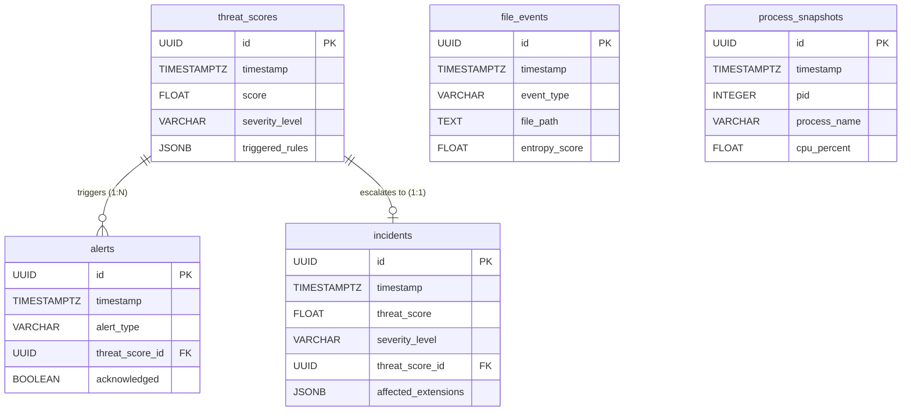

# RDRS Database Schema Documentation

This document outlines the PostgreSQL relational database architecture that underpins the RDRS telemetry, scoring, and incident orchestration engine.

---

## 1. Entity Relationship Diagram (ERD)

The following Mermaid ERD visualizes the 1-to-many relationships across the five core tables:

---

## 2. Table Definitions

### 2.1 `threat_scores`
Acts as the central timeline of the sliding-window engine. Every time the engine evaluates the temporal window, a new threat score is persisted.

| Column | Type | Index | Description |
| :--- | :--- | :---: | :--- |
| `id` | `UUID` | PK | Primary Key. Server-generated v4 UUID. |
| `timestamp` | `TIMESTAMPTZ` | B-Tree | Exact UTC timestamp of the calculation. |
| `score` | `FLOAT` | B-Tree | The calculated composite score (0.0 to 100.0). |
| `severity_level` | `VARCHAR` | B-Tree | Enum mapping (`NORMAL`, `WARNING`, `CRITICAL`). |
| `triggered_rules` | `JSONB` | - | **JSONB Data**: Array of active heuristic rules. |
| `signal_breakdown` | `JSONB` | - | **JSONB Data**: Detailed numeric breakdown of signal weight. |

### 2.2 `alerts`
Generated dynamically when a specific Threat Score breaches an alerting threshold.

| Column | Type | Index | Description |
| :--- | :--- | :---: | :--- |
| `id` | `UUID` | PK | Primary Key. |
| `timestamp` | `TIMESTAMPTZ` | B-Tree | Exact UTC generation timestamp. |
| `alert_type` | `VARCHAR` | B-Tree | Categorization (e.g., `HIGH_ENTROPY_DETECTED`). |
| `threat_score_id` | `UUID` | FK | Foreign Key linking back to the `threat_scores` table. |
| `acknowledged` | `BOOLEAN` | B-Tree | State flag for SOC operator UI management. |
| `raw_context` | `JSONB` | - | **JSONB Data**: Detector-specific raw context at generation. |

### 2.3 `incidents`
Consolidated incident records that aggregate massive bursts of file/process activity into a single investigable entity.

| Column | Type | Index | Description |
| :--- | :--- | :---: | :--- |
| `id` | `UUID` | PK | Primary Key. |
| `timestamp` | `TIMESTAMPTZ` | B-Tree | Exact UTC timestamp of incident declaration. |
| `threat_score_id` | `UUID` | FK | The critical score that spawned the incident. |
| `suspect_process_pid`| `INTEGER` | - | The isolated PID of the ransomware executable. |
| `affected_extensions`| `JSONB` | - | **JSONB Data**: Array of mutated extensions (e.g., `[".locked"]`). |
| `quarantine_path` | `TEXT` | - | Location of safely duplicated evidence. |

### 2.4 `file_events`
An append-only log of every monitored filesystem mutation. 

| Column | Type | Index | Description |
| :--- | :--- | :---: | :--- |
| `id` | `UUID` | PK | Primary Key. |
| `timestamp` | `TIMESTAMPTZ` | B-Tree | Time the OS emitted the event. |
| `event_type` | `VARCHAR` | B-Tree | Enum (`created`, `modified`, `deleted`, `renamed`). |
| `file_path` | `TEXT` | - | Absolute location on disk. |
| `entropy_score` | `FLOAT` | - | Result of Shannon Entropy algorithm (0.0 to 8.0). |

### 2.5 `process_snapshots`
High-frequency telemetry sampling `psutil` data.

| Column | Type | Index | Description |
| :--- | :--- | :---: | :--- |
| `id` | `UUID` | PK | Primary Key. |
| `timestamp` | `TIMESTAMPTZ` | B-Tree | Time of the metric capture. |
| `pid` | `INTEGER` | B-Tree | OS Process ID. |
| `process_name` | `VARCHAR` | B-Tree | Executable name (e.g., `python.exe`). |
| `cpu_percent` | `FLOAT` | - | CPU utilization snapshot. |
| `disk_write_bytes` | `BIGINT` | - | Cumulative I/O metric for burst detection. |

---

## 3. Core Database Design Decisions

*   **JSONB Utilization**: Rather than creating rigid schema columns for dynamic heuristic properties (which change frequently during detector development), we extensively utilize PostgreSQL `JSONB` columns (`triggered_rules`, `raw_context`, `affected_extensions`). This allows flexible, schemaless inserts while retaining the ability to execute high-performance GIN-indexed JSON queries if needed in the future.
*   **TIMESTAMPTZ Enforcement**: Ransomware investigations require microscopic chronological accuracy. By enforcing `TIMESTAMPTZ` across all timestamp columns, PostgreSQL universally stores the data in strict UTC, avoiding naive datetime timezone drift when querying from disparate geographic SOC dashboards.
*   **Server-Side UUID Generation**: All primary keys are UUIDv4 generated at the server-level (`server_default=func.gen_random_uuid()`), preventing Python-layer generation collisions and enabling highly distributed inserts during massive ransomware bursts.
